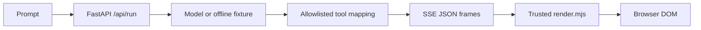

# 01.1 Static components

## What this lesson demonstrates

Static generative UI: an agent selects one of three prebuilt components and supplies typed props. The application owns layout and the renderer never receives model-provided markup.

## Prerequisites and source

Python 3.9+ with FastAPI, Uvicorn, pytest and httpx. Node 22+ is recommended for the renderer test. This is adapted from the official [source lesson](https://github.com/dlmastery/simple-coding-harness/tree/main/genui/01_foundations/step_01_static_components), checked 2026-11-04. The local offline demo is a deterministic fixture, not a live model call.

## Architecture and trust boundary



The model can choose `Metric`, `Table`, or `Chart` through tool names. It cannot choose arbitrary tags, CSS, or actions. Props are escaped before insertion.

## Quick start

```bash
python3 -m pytest test_step.py
node --test tests/render.test.mjs
python3 demo.py --offline
```

For a live run, install the OpenAI SDK, set `API_KEY` in the ignored root `.env` or environment, and run `python3 server.py`; missing credentials remain a visible error frame.

## Source walkthrough

- `catalog.py`: strict tool schemas and the allowlisted tool-to-component mapping.
- `llm.py`: optional OpenAI-compatible streamed tool-call assembly.
- `server.py`: SSE framing, terminal error frame, and disconnect handling.
- `page/render.mjs`: escaped trusted renderers.
- `page/app.js`: SSE reader and terminal browser state.
- `demo.py`: explicit offline fixture runner.

## Wire format

Each frame is `data: <JSON>\n\n`. A component frame has `{ "component": "Metric", "props": { ... } }`; the final frame has `{ "done": true, ... }`. The local fixture emits two component frames and a usage frame.

## Execution and failure cases

`python3 demo.py --offline` prints `mode: OFFLINE FIXTURE` and the actual frames. Tests cover strict schemas, unknown components, invalid JSON, escaped props, and provider failure becoming a terminal error frame. No live provider call was verified in this environment.

## Mode and protocol context

This lesson teaches static generation. SSE is only the transport used by this local example; it is not AG-UI. Declarative layout, open-ended HTML, and hybrid composition are later lessons.

## Security and limitations

Props are treated as untrusted text and component names are checked with an own-property lookup. This lesson has no authentication and is local-only. The live SDK is optional and no credentials are committed.

## Video

`NOT PUBLISHED - see ../../../../video/MANIFEST.md`. Recording is `NOT_STARTED`; no video is claimed.

## Next lesson

[01.2 declarative tree](../step_02_declarative_tree/README.md) (not implemented yet).

